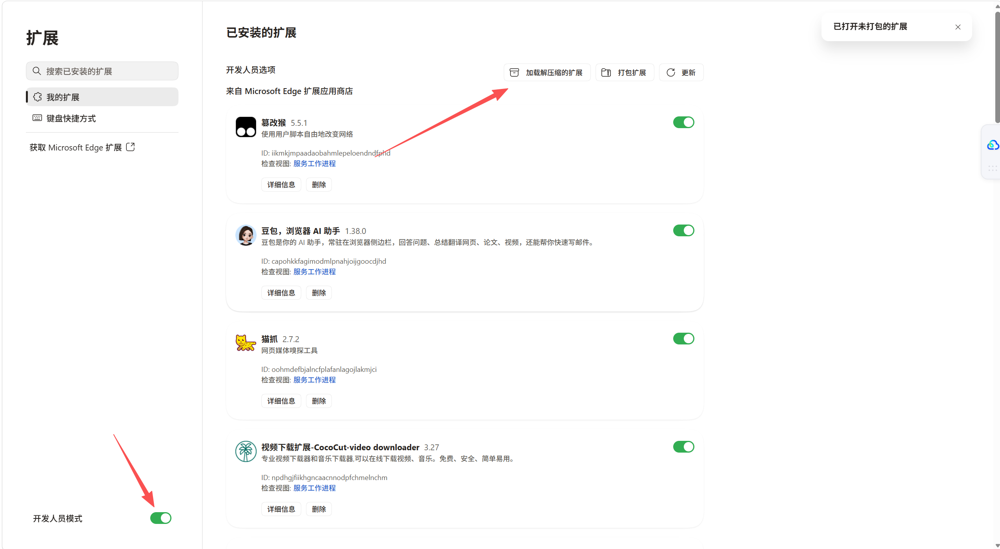
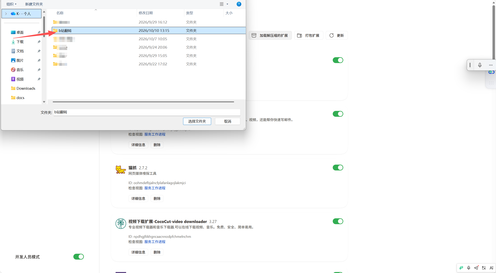
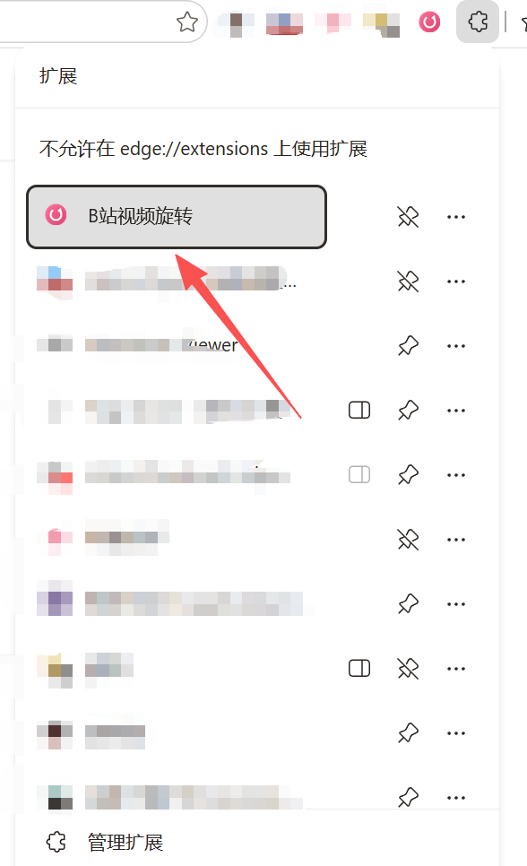
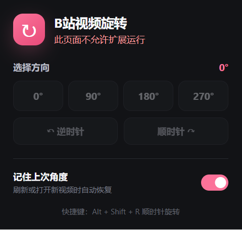

# B站视频旋转

一个轻量的 Manifest V3 浏览器扩展，用于旋转网页里的主视频，重点适配哔哩哔哩 Web 播放器。

## 功能

- 一键切换 `0° / 90° / 180° / 270°`
- 顺时针、逆时针逐次旋转
- 90° 与 270° 时自动缩放，完整显示画面
- 兼容 B 站普通模式、网页全屏和浏览器全屏
- 监听动态播放器，B 站切集或播放器重建后自动重新应用
- 可选择刷新页面后恢复上次角度
- 快捷键：`Alt + Shift + R` 顺时针、`Alt + Shift + L` 逆时针
- 除 B 站外，也可以点击扩展图标后临时用于其他 HTML5 视频网站

## 安装

推荐从 Microsoft Edge 加载项商店安装；如果暂时无法使用商店，也可以下载本仓库并手动安装。

### Microsoft Edge 手动安装图文教程

#### 1. 下载并解压扩展

下载 [`dist/bilibili-video-rotate-edge-v1.0.1.zip`](dist/bilibili-video-rotate-edge-v1.0.1.zip)，然后右键压缩包选择“全部解压”。浏览器不能直接安装 `.zip` 文件。

建议把解压后的文件夹放在“文档”等不会被系统自动清理的位置。安装后不要移动或删除这个文件夹。

#### 2. 打开扩展管理页

在 Edge 地址栏输入 `edge://extensions/` 并按回车，然后打开左下角的“开发人员模式”，点击页面上方的“加载解压缩的扩展”。



#### 3. 选择扩展文件夹

在弹出的文件夹选择窗口中，选择刚才解压得到的文件夹，然后点击“选择文件夹”。所选文件夹第一层必须直接包含 `manifest.json`。



正确的目录结构类似：

```text
bilibili-video-rotate\
├─ manifest.json
├─ background.js
├─ content.css
├─ icons\
├─ popup\
└─ src\
```

如果提示“清单文件缺失或不可读取”，通常是选中了外层文件夹，请再进入一层并选择直接包含 `manifest.json` 的目录。

#### 4. 确认扩展已经启用

安装成功后，扩展列表中会出现“B站视频旋转”。确认右上角开关为绿色开启状态。


#### 5. 找到并固定扩展

点击 Edge 工具栏右上角的拼图图标，在扩展列表中找到“B站视频旋转”。可以点击名称打开扩展，也可以点击右侧的图钉按钮将它固定到工具栏。



#### 6. 打开视频页面后使用

先打开一个哔哩哔哩视频页面，等待播放器加载完成，再点击“B站视频旋转”图标并选择 `0°`、`90°`、`180°` 或 `270°`。

如果在 `edge://extensions/`、Edge 加载项商店或其他浏览器内部页面点击扩展，会看到“此页面不允许扩展运行”，这是浏览器的正常安全限制，不代表安装失败。切换到普通视频网页即可使用。



### Google Chrome 手动安装

Chrome 的操作基本相同：

1. 下载项目压缩包并解压，不能直接选择 `.zip` 文件。
2. 在 Chrome 打开 `chrome://extensions/`。
3. 开启右上角的“开发者模式”。
4. 点击“加载已解压的扩展程序”。
5. 选择解压后**直接包含 `manifest.json`** 的文件夹。

更新方法、快捷键、卸载步骤和更多故障排查请阅读：

**[手动安装与使用教程](docs/manual-install.md)**

> 手动加载的扩展必须保持开发者模式开启，这是 Chromium 浏览器的安全机制。关闭开发者模式后，手动安装的扩展会被停用；从官方商店安装的版本不需要开启开发者模式。

## 权限说明

- `storage`：保存“记住上次角度”的设置。
- `activeTab`：只在用户点击扩展或按快捷键时，临时作用于当前非 B 站网页。
- `scripting`：把旋转逻辑注入用户主动操作的当前网页。
- `bilibili.com` 主机权限：让 B 站播放器在页面加载和动态切集后持续可用。

扩展不联网、不收集数据，也不读取视频内容。

## 快捷键设置

浏览器可能占用某些组合键。可在 `chrome://extensions/shortcuts` 或 `edge://extensions/shortcuts` 中重新绑定，也可以给“恢复视频方向”添加快捷键。

## 开发与验证

核心角度和缩放计算不依赖第三方库：

```powershell
node tests/core.test.js
```

重新生成图标：

```powershell
powershell -ExecutionPolicy Bypass -File tools/make-icons.ps1
```

## Edge 商店上架材料

完整的 Partner Center 文案、隐私政策、权限说明、审核步骤、300×300 Logo 和 1280×800 截图位于 `store/`。商店专用扩展包可使用以下命令重新生成：

```powershell
powershell -ExecutionPolicy Bypass -File tools/build-store-package.ps1
```

提交前请按 `store/submission-checklist.md` 替换联系邮箱并完成账号侧信息。

## 实现说明

扩展只给检测到的主 `<video>` 元素添加 CSS 变换，因此播放器控制栏和弹幕层保持正常方向。主视频通过播放器容器优先级与可见面积判断；`MutationObserver` 处理单页导航和播放器替换，`ResizeObserver` 处理全屏与窗口尺寸变化。

对于 90°/270°，缩放比例按 `min(宽/高, 高/宽)` 计算，避免旋转后的画面被播放器边界裁切。
